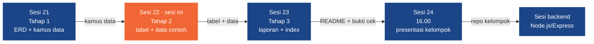

# 22 - Oracle DDL, DML & Basic SQL

Sesi ini mengubah ERD menjadi tabel Oracle, dikerjakan dalam dua bagian. Di Demo 1-4, kasus Tabungan UMKM (fitur keuangan digital untuk nasabah UMKM sebuah bank fiktif) dibangun bersama: 4 tabel dengan constraint di schema `ALP_DEV`, data contoh yang sama di semua laptop, bukti bahwa constraint menolak data yang salah, dan 8 query laporan dasar. Di Lab, kelompok menerapkan hal yang sama untuk ALP-nya sendiri di repo kelompok (Tahap 2 dari 3): `db/01-ddl.sql`, `db/02-seed.sql`, `db/03-test-invalid.sql`, dan `db/00-run-all.sql`, dengan rubrik 100 poin sebagai panduan.

## Environment & Tools

Sama dengan sesi 21. Tidak ada instalasi baru.

| Item | Cara cek | Harus terlihat |
| --- | --- | --- |
| Container Oracle | `docker ps` | `oracle-alp` dengan status `Up ... (healthy)`. Kalau mati: buka Docker Desktop, `docker start oracle-alp`, tunggu `(healthy)` |
| Koneksi SQL client | Panel **SQL Developer** → **Connections** | `ALP_DEV @ FREEPDB1` ada dan bisa dibuka |
| Ekstensi | VS Code → Extensions | Oracle SQL Developer for VS Code 26.3.1 |

Versi dicek 22 Nov 2026: Oracle AI Database 26ai Free 23.26.4.0.0 (`container-registry.oracle.com/database/free:23.26.4.0-lite`), Docker Desktop (Docker Engine 29.9.3), Oracle SQL Developer for VS Code 26.3.1.

**Auto Commit mati.** Koneksi SQL Developer for VS Code dibuat dengan Auto Commit tidak dicentang (default). Artinya `INSERT`, `UPDATE`, dan `DELETE` belum permanen sampai `COMMIT` dijalankan. Session lain (aplikasi, anggota kelompok lain, sesi 23) tidak melihat data yang belum di-commit.

### Cara menjalankan SQL di VS Code

| Aksi | Cara | Hasil tampil di |
| --- | --- | --- |
| Pasang koneksi ke file `.sql` | Klik `No connection attached` di status bar bawah (atau ikon **Attach Connection** di kanan atas editor), pilih `ALP_DEV @ FREEPDB1` | Status bar berubah menjadi `(Dedicated) ALP_DEV @ FREEPDB1` |
| Jalankan satu perintah | Taruh kursor di perintah, tekan **Run Statement**: `Ctrl+Enter` (Windows/Linux) atau `⌘Enter` (macOS) | Tab **Query Result** (SELECT) atau **Script Output** |
| Jalankan seluruh file | **Run Script**: `F5` | Tab **Script Output** |

## Posisi Sesi di Project

Database ALP dibangun dalam tiga tahap selama sesi 21-23, lalu dipresentasikan di akhir sesi 24.

| Tahap | Kapan | Hasil di repo kelompok |
| --- | --- | --- |
| 1 · ERD dan kamus data | Sesi 21 (hari 1 pagi) | `docs/erd.drawio.png`, `docs/kamus-data.md`, `docs/review.md` |
| **2 · Database** | **Sesi 22 (hari 1 siang), lanjut malam hari 1** | **`db/00` sampai `03`, README bagian "Aturan data penting"** |
| 3 · Laporan dan optimasi | Sesi 23 (hari 2 pagi) | `db/04` sampai `07` |

Demo = kasus Tabungan UMKM, dikerjakan sendiri-sendiri di laptop masing-masing. Lab = hal yang sama untuk tema kelompok (Perbankan, E-commerce, atau Logistik). Instruktur menayangkan contoh hasil akhir per bagian di layar; filenya tidak dibagikan.

## Dari Demo ke Tema Kelompok

Setiap jenis aturan di Demo punya padanan di tema kelompok. Pakai tabel ini untuk memilih constraint yang bermakna bagi tabel kelompok. Nama constraint di kolom tema berasal dari contoh hasil akhir tiap tema (awalan `KAS_`, `MKT_`, `KRM_`).

| Jenis aturan | Demo (Tabungan UMKM) | Perbankan | E-commerce | Logistik |
| --- | --- | --- | --- | --- |
| `CHECK` angka | `ck_accounts_balance` (saldo ≥ 0) | `ck_kas_accounts_balance` (saldo ≥ 0) | `ck_mkt_products_stock` (stok ≥ 0) | `ck_krm_shipments_weight` (berat 0-1.000 kg) |
| `CHECK` daftar nilai | `ck_accounts_status` | `ck_kas_accounts_type` (jenis akun) | `ck_mkt_orders_status` (status pesanan) | `ck_krm_shipments_status` (status kiriman) |
| `UNIQUE` | `uq_customers_email` | `uq_kas_transactions_ref` (nomor referensi) | `uq_mkt_products_sku`, `uq_mkt_payments_order` (satu pembayaran per pesanan) | `uq_krm_shipments_tracking` (nomor resi) |
| `FOREIGN KEY` | `fk_transactions_account` | `fk_kas_transactions_account` | `fk_mkt_orders_buyer`, `fk_mkt_order_items_order` | `fk_krm_shipments_courier` (boleh kosong: belum ada kurir), `fk_krm_status_history_shipment` |
| `CHECK` lintas kolom | `ck_accounts_closed` (Tantangan tambahan Demo 1) | `ck_kas_app_users_umkm` (pemilik wajib punya UMKM) | `ck_mkt_app_users_owner` | `ck_krm_shipments_delivered` (`TERKIRIM` wajib punya waktu diterima) |
| Pengguna + role | - | `ck_kas_app_users_role`: `ADMIN`, `PEMILIK`, `STAF` | `ck_mkt_app_users_role`: `ADMIN`, `PENJUAL`, `PEMBELI` | `ck_krm_app_users_role`: `ADMIN`, `PETUGAS`, `KURIR` |

Tabel user + role (`<awalan>_APP_USERS`) wajib ada di setiap kelompok: `username` UNIQUE, `password_hash`, `role` dengan `CHECK` daftar nilai, dan FK ke entity pemilik akun (boleh kosong untuk `ADMIN`). Dipakai untuk login dan JWT di sesi 34.

## Struktur Repo

| Folder | Isi |
| --- | --- |
| [`demo-1/`](demo-1/) | Demo 1 · Buat Tabel Tabungan UMKM |
| [`demo-2/`](demo-2/) | Demo 2 · Load Seed dan DML |
| [`demo-3/`](demo-3/) | Demo 3 · Test Invalid Input |
| [`demo-4/`](demo-4/) | Demo 4 · Query Laporan Dasar |
| [`lab/`](lab/) | Lab · Tahap 2 Project: Database Kelompok |

Setiap folder punya `README.md` berisi langkahnya. Kerjakan berurutan: `demo-1` sampai `demo-4`, lalu `lab`.

## Studi Kasus

**Tabungan UMKM**: bank fiktif dengan cabang, nasabah perorangan dan UMKM, rekening, dan transaksi. Di sesi 21 kasus ini sudah digambar sebagai ERD 4 entity oleh tim contoh. Sekarang ERD itu dijadikan tabel, diisi data simulasi, lalu dipakai untuk laporan. Tabel dan data yang sama dipakai lagi di sesi 23 dan sesi REST API.

## Bantuan

- [TROUBLESHOOTING.md](TROUBLESHOOTING.md): pesan error dan cara memperbaikinya.
- [CHECKLIST.md](CHECKLIST.md): hasil yang harus terlihat dan kriteria selesai.

## Cleanup

Tabel dan data Tabungan UMKM dipakai di sesi 23, dan database kelompok dari `00-run-all.sql` dipakai di Lab sesi 23. Setelah selesai: `docker stop oracle-alp`.

Sesi 23 memakai data ini untuk query lintas tabel (JOIN), transfer dengan transaksi, dan optimasi query dengan index.
