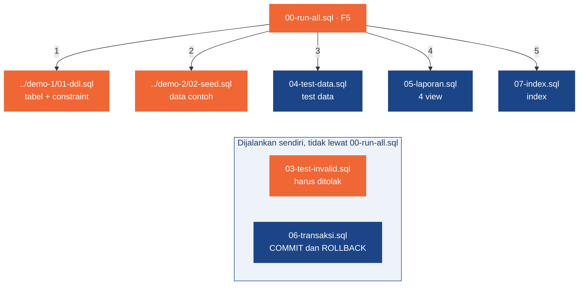

# Lab · Tahap 2 Project: Database Kelompok

[Persiapan](../README.md) · [Troubleshooting](../TROUBLESHOOTING.md)

**Skenario.** Seperti tim contoh yang membangun database Tabungan UMKM di Demo, kelompok membangun database ALP-nya sendiri. ERD dan kamus data dari sesi 21 (`docs/kamus-data.md` di repo kelompok) menjadi `db/01-ddl.sql`, lalu data contoh, test invalid input, dan satu perintah yang membangun ulang semuanya. Hasilnya dipakai sesi 23 (laporan dan optimasi) dan sesi backend. Instruktur menayangkan contoh hasil akhir per bagian di layar.

**Pola kerja repo.** Satu anggota menjadi driver dan mengetik di laptopnya; anggota lain membaca, mengusulkan, dan menjalankan di laptop masing-masing. Setiap perubahan di-commit dan di-push oleh driver, anggota lain `git pull`. Setelah `00-run-all.sql` selesai, **semua anggota** membangun database kelompok di laptopnya sendiri (schema `ALP_DEV` milik laptop itu).

Langkah (kelompok):

1. `git pull` di repo kelompok. Buka `docs/kamus-data.md` dan `docs/erd.drawio.png` (sudah diperbaiki sesuai `docs/review.md`).
2. Tulis `db/01-ddl.sql` dari kamus data. File template `db/01-ddl.sql` sudah berisi pola dan komentar petunjuk.

   - Awalan tabel kelompok (2-4 huruf, mis. `GRD_`), supaya tidak bentrok dengan tabel Tabungan UMKM.

   - `DROP ... IF EXISTS` (view, lalu tabel child → parent) dan `CREATE TABLE` (parent → child), constraint bernama `pk_`, `uq_`, `fk_`, `ck_` (lihat Dari Demo ke Tema Kelompok).

   - Tabel user + role `<awalan>_APP_USERS` dengan `CHECK` daftar role.

   - `COMMENT ON TABLE` satu kalimat untuk setiap tabel.

3. Tulis `db/02-seed.sql`: minimal 3 baris per tabel, data simulasi (kode berpenanda `SIM`, email `example.com`), `password_hash` berisi teks penanda seperti `HASH-SIMULASI-BUKAN-PASSWORD`, diakhiri `COMMIT`. Sisakan satu data parent yang sengaja belum punya pasangan (akun belum dipakai, produk belum pernah dipesan, kurir belum ditugaskan); dipakai laporan di sesi 23.
4. Tulis `db/03-test-invalid.sql`: minimal 3 perintah yang harus ditolak, kode ORA dan nama constraint ditulis di komentar atas perintahnya. File ini tidak dipanggil `00-run-all.sql`.
5. Lengkapi `db/00-run-all.sql`: pemanggilan `@@01`, `@@02`, `@@04`, `@@05`, `@@07` sudah ada di template (`03` dan `06` sengaja tidak dipanggil; file yang belum diisi aman dipanggil); tambahkan query ringkasan jumlah baris tiap tabel. Jalankan dengan **F5** **dua kali berturut-turut** tanpa error.
6. Buka `cek-lab.sql` sesi 22 (folder `lab` di repo `dev-sesi-22`, atau folder `challenge` di ZIP lab sesi 22), ganti awalan di baris `DEFINE awalan = 'GRD'`, pasang koneksi, tekan **F5**. Perbaiki sampai skor otomatis minimal 48 dari 80. File ini tidak perlu disalin ke repo kelompok.
7. Isi bagian **Aturan data penting** di `README.md` repo (minimal 3 aturan: aturan, nama constraint, alasan bisnis). Commit dan push.

Struktur `db/` di repo kelompok (oranye = diisi di Lab 22, biru = menyusul di sesi 23):

**Target malam hari 1.** Di kelas ±35 menit cukup untuk kerangka `db/01-ddl.sql`. Yang belum selesai dirampungkan malam ini: `db/01` sampai `03` lengkap, `00-run-all.sql` jalan dua kali tanpa error di laptop setiap anggota, `cek-lab.sql` minimal 48 dari 80, README bagian masalah, fitur MVP, dan aturan data penting. Besok pagi (sesi 23) kelompok melanjutkan dari repo yang sama ke `db/04` sampai `07`.

## Rubrik Lab (100 poin)

| Kriteria | Poin | Dinilai oleh | Indikator keberhasilan |
| --- | --- | --- | --- |
| Jumlah tabel | 20 | `cek-lab.sql` | Minimal 3 tabel berawalan kelompok, satu tabel untuk setiap entity di ERD |
| Primary key | 15 | `cek-lab.sql` | Setiap tabel punya PK identity (termasuk `<awalan>_APP_USERS`) |
| Relasi FK | 15 | `cek-lab.sql` | Minimal jumlah tabel dikurangi 1 FK; relasi N:M memakai tabel penghubung dengan dua FK |
| Constraint bernama | 10 | `cek-lab.sql` | Semua constraint memakai pola `pk_`, `uq_`, `fk_`, `ck_` |
| Aturan data | 10 | `cek-lab.sql` | Minimal 2 constraint `CHECK` atau `UNIQUE` yang bermakna bisnis |
| Data contoh | 10 | `cek-lab.sql` | Minimal 3 baris per tabel, data simulasi, diakhiri `COMMIT` |
| Test invalid input | 10 | Instruktur atau kelompok lain | Minimal 3 perintah di `db/03-test-invalid.sql` yang ditolak, kode ORA dicatat di komentar |
| Idempoten | 5 | Instruktur atau kelompok lain | `db/00-run-all.sql` dijalankan dua kali berturut-turut (F5) tanpa error |
| Cocok kamus data | 5 | Instruktur atau kelompok lain | Nama tabel, kolom, dan tipe sama dengan ERD dan kamus data kelompok |
| **Total** | **100** | | |

Rubrik ini panduan dan alat cek sendiri. Nilai project diberikan saat presentasi kelompok di sesi 24 (skor `cek-lab.sql` ditempel di README bagian "Bukti cek"). Skor di bawah 60 saat waktu kelas habis: lanjutkan malam hari 1 sampai memenuhi rubrik.

## Bonus Lab (opsional, maks. +10)

1. Tambahkan kolom audit `updated_at TIMESTAMP` ke semua tabel kelompok dengan `ALTER TABLE`. Buktikan dengan satu query ke `USER_TAB_COLUMNS` bahwa kolom itu ada di setiap tabel berawalan kelompok. Kalau kolomnya dimasukkan ke repo, tulis di `db/01-ddl.sql` (bukan `ALTER` terpisah) supaya `00-run-all.sql` tetap bisa dijalankan dua kali.
2. Cocokkan DDL dengan `docs/kamus-data.md` kelompok dari sesi 21: untuk satu tabel, tampilkan nama kolom, tipe, panjang atau presisi, dan wajib diisi (`nullable`) dari `USER_TAB_COLUMNS`, lalu cari selisih dengan kamus. Perbaiki yang berbeda, kamus atau DDL, lalu commit.
